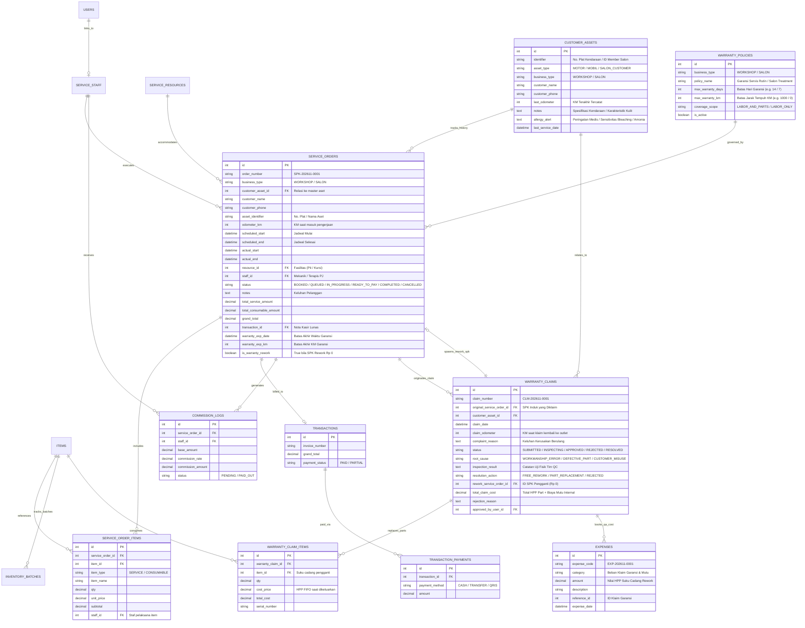
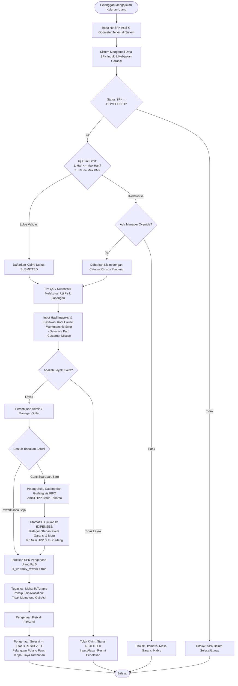
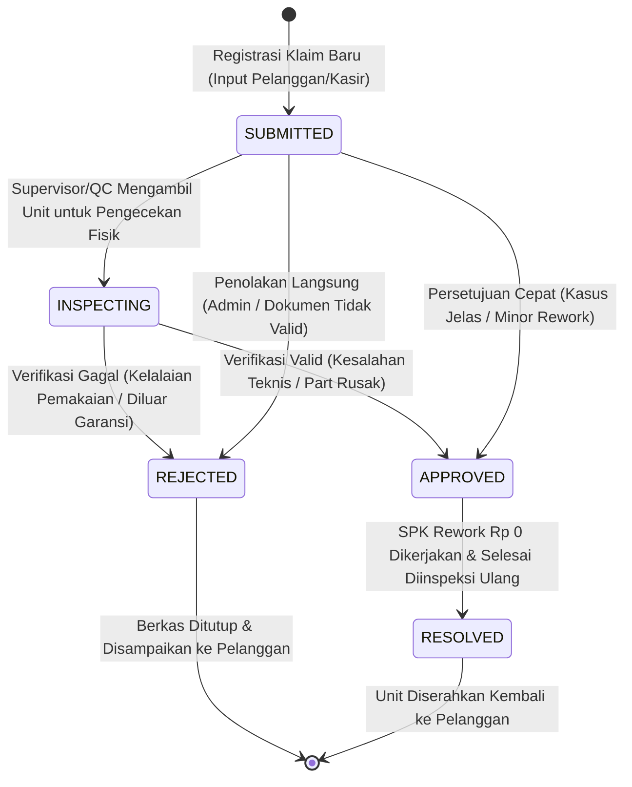

# Arsitektur Teknis & Skema Data (ARCHITECTURE.md)
## SSCM — Service Supply Chain Management System
### Dilengkapi Modul Terpadu: Bengkel, Salon, Klaim Garansi & Riwayat Servis Lengkap

Dokumen ini mendefinisikan arsitektur sistem, skema database relasional (Knex / SQLite), algoritma validasi bisnis (termasuk *Dual-Limit Warranty Engine* dan *Fair-Allocation Commission Engine*), serta spesifikasi antarmuka frontend berbasis arsitektur SPA modular selaras dengan desain **TokoJendral**.

---

## 1. Diagram Arsitektur Tingkat Tinggi (High-Level Architecture)

```
+---------------------------------------------------------------------------------------------------------+
|                                    FRONTEND: Modular Vanilla JS SPA                                     |
|  - public/index.html (Login) & public/pages/dashboard.html                                              |
|  - Components:                                                                                          |
|    * Sidebar.js      : Menu Dinamis (Dashboard, Layanan & Antrean, Kasir POS, Aset & Garansi, Komisi)  |
|    * Services.js     : Papan Antrean Kanban 4 Kolom, Form Reservasi & SPK, Collision Guard               |
|    * POS.js          : Kasir Point of Sale, Load SPK, Split/Multi-Payment, Cetak Struk                  |
|    * Warranty.js     : Papan Klaim Garansi, QC Inspection, Approval SPK Rp 0, Riwayat Aset & Alergi    |
|    * Commissions.js  : Rekapitulasi Komisi Staf & Pencairan Insentif Bersih                            |
|    * Items.js        : Manajemen Katalog Jasa & Stok Bahan Habis Pakai                                   |
|  - Utilities: api.js (Fetch/JWT Client), format.js (Rupiah, Waktu, Badges Status)                       |
|  - CSS: style.css (TokoJendral Modern SaaS UI: Card, Modals, Stats Grid, Table Containers)              |
+----------------------------------------------------+----------------------------------------------------+
                                                     | REST API (JSON + Bearer JWT)
+----------------------------------------------------v----------------------------------------------------+
|                                      BACKEND: Express.js (v5.x)                                         |
|  - Middleware: auth.js, rbac.js, validate.js                                                            |
|  - Controllers:                                                                                         |
|    * AuthController, ServiceController, POSController, CommissionController                             |
|    * AssetController, WarrantyController                                                                |
|  - Services:                                                                                            |
|    * CollisionEngineService       : Validasi Bebas Tabrakan (Fasilitas x Staf x Waktu)                  |
|    * ServiceOrderService          : Lifecycle SPK (BOOKED -> QUEUED -> IN_PROGRESS -> READY_TO_PAY)    |
|    * FIFOInventoryService         : Pemotongan Stok Akurat Berdasarkan Urutan Batch Masuk Gudang        |
|    * CommissionCalculationService : Kalkulasi Komisi Proporsional Sesuai Hak Staf                       |
|    * AssetService                 : Agregasi Rekam Jejak / Lifecycle Aset & Warning Alergi               |
|    * WarrantyService              : Dual-Limit Engine (Hari & KM), Penerbitan SPK Rework Rp 0, Beban QA |
+----------------------------------------------------+----------------------------------------------------+
                                                     | Knex.js Query Builder
+----------------------------------------------------v----------------------------------------------------+
|                                  DATABASE: SQLite3 (better-sqlite3)                                     |
|  - TokoJendral Core : users, items, inventory_batches, transactions, transaction_payments               |
|  - SSCM Domain      : service_resources, service_staff, service_orders, service_order_items,             |
|                       commission_logs                                                                   |
|  - Warranty & Asset : customer_assets, warranty_policies, warranty_claims, warranty_claim_items,        |
|                       expenses (Beban Mutu & Klaim Garansi Internal)                                    |
+---------------------------------------------------------------------------------------------------------+
```

---

## 2. Entity-Relationship Diagram (ERD)

Diagram di bawah ini menggambarkan seluruh model relasional entitas, mencakup modul Reservasi, Antrean, Kasir POS, Komisi, hingga Siklus Klaim Garansi dan Riwayat Servis Aset Pelanggan:



---

## 3. Spesifikasi Skema & Kamus Data Teknis

### A. Tabel `customer_assets` (Master Aset & Rekam Medis Servis)
Merekam seluruh unit kendaraan maupun profil pelanggan salon untuk pelacakan riwayat lintas waktu:
* `id`: INTEGER PRIMARY KEY AUTOINCREMENT
* `identifier`: VARCHAR(100) NOT NULL UNIQUE (Contoh: `'B 4128 SZZ'`, `'CUST-SLN-001'`)
* `asset_type`: VARCHAR(50) DEFAULT `'MOTOR'` (`'MOTOR'`, `'MOBIL'`, `'SALON_CUSTOMER'`)
* `business_type`: VARCHAR(20) NOT NULL CHECK (`business_type` IN (`'WORKSHOP'`, `'SALON'`))
* `customer_name`: VARCHAR(100) NOT NULL
* `customer_phone`: VARCHAR(30)
* `last_odometer`: INTEGER DEFAULT 0 (Khusus bengkel)
* `notes`: TEXT (Keterangan model/tipe, misal: `'Toyota Avanza 1.5G 2021'`)
* `allergy_alert`: TEXT (Peringatan medis khusus salon: `'Sensitif zat amonia bleaching / iritasi kulit kepala'`)
* `last_service_date`: DATETIME NULL
* `created_at`, `updated_at`: DATETIME DEFAULT CURRENT_TIMESTAMP

### B. Tabel `warranty_policies` (Aturan & Batasan Garansi)
Mendefinisikan ketentuan masa aktif garansi per lini bisnis:
* `id`: INTEGER PRIMARY KEY AUTOINCREMENT
* `business_type`: VARCHAR(20) NOT NULL
* `policy_name`: VARCHAR(100) NOT NULL (Contoh: `'Garansi Servis Rutin & Tune-up'`)
* `max_warranty_days`: INTEGER NOT NULL DEFAULT 14 (Maksimal hari)
* `max_warranty_km`: INTEGER NOT NULL DEFAULT 1000 (Maksimal jarak tempuh, 0 untuk salon)
* `coverage_scope`: VARCHAR(50) DEFAULT `'LABOR_AND_PARTS'` (`'LABOR_AND_PARTS'`, `'LABOR_ONLY'`)
* `terms_conditions`: TEXT
* `is_active`: BOOLEAN DEFAULT 1

### C. Tabel `service_orders` (Pusat Lifecycle SPK - Diperkaya)
Diperluas dengan integrasi garansi dan identitas aset:
* `id`: INTEGER PRIMARY KEY AUTOINCREMENT
* `order_number`: VARCHAR(30) UNIQUE NOT NULL (Contoh: `'SPK-202611-0001'`)
* `business_type`: VARCHAR(20) NOT NULL
* `customer_asset_id`: INTEGER NULL REFERENCES `customer_assets(id)`
* `customer_name`: VARCHAR(100) NOT NULL
* `customer_phone`: VARCHAR(30)
* `asset_identifier`: VARCHAR(100) NOT NULL
* `odometer_km`: INTEGER DEFAULT 0
* `scheduled_start`, `scheduled_end`: DATETIME NOT NULL
* `actual_start`, `actual_end`: DATETIME NULL
* `resource_id`: INTEGER NOT NULL REFERENCES `service_resources(id)`
* `staff_id`: INTEGER NOT NULL REFERENCES `service_staff(id)`
* `status`: VARCHAR(20) DEFAULT `'BOOKED'`
* `notes`: TEXT
* `total_service_amount`: DECIMAL(12,2) DEFAULT 0.00
* `total_consumable_amount`: DECIMAL(12,2) DEFAULT 0.00
* `grand_total`: DECIMAL(12,2) DEFAULT 0.00
* `transaction_id`: INTEGER NULL REFERENCES `transactions(id)`
* `warranty_exp_date`: DATETIME NULL (Dihitung otomatis saat status `COMPLETED`)
* `warranty_exp_km`: INTEGER NULL (Odometer awal + Batas KM)
* `is_warranty_rework`: BOOLEAN DEFAULT 0 (True jika diterbitkan dari klaim garansi Rp 0)

### D. Tabel `warranty_claims` (Pencatatan & Putusan Klaim Garansi)
* `id`: INTEGER PRIMARY KEY AUTOINCREMENT
* `claim_number`: VARCHAR(30) UNIQUE NOT NULL (Contoh: `'CLM-202611-0001'`)
* `original_service_order_id`: INTEGER NOT NULL REFERENCES `service_orders(id)`
* `customer_asset_id`: INTEGER NULL REFERENCES `customer_assets(id)`
* `claim_date`: DATETIME DEFAULT CURRENT_TIMESTAMP
* `claim_odometer`: INTEGER DEFAULT 0
* `complaint_reason`: TEXT NOT NULL
* `status`: VARCHAR(20) DEFAULT `'SUBMITTED'` CHECK (`status` IN (`'SUBMITTED'`, `'INSPECTING'`, `'APPROVED'`, `'REJECTED'`, `'RESOLVED'`))
* `root_cause`: VARCHAR(50) NULL (`'WORKMANSHIP_ERROR'`, `'DEFECTIVE_PART'`, `'CUSTOMER_MISUSE'`, `'OUTSIDE_WARRANTY_SCOPE'`)
* `inspection_result`: TEXT NULL
* `resolution_action`: VARCHAR(50) NULL (`'FREE_REWORK'`, `'PART_REPLACEMENT'`, `'REJECTED'`)
* `rework_service_order_id`: INTEGER NULL REFERENCES `service_orders(id)`
* `total_claim_cost`: DECIMAL(12,2) DEFAULT 0.00
* `rejection_reason`: TEXT NULL
* `approved_by_user_id`: INTEGER NULL REFERENCES `users(id)`

### E. Tabel `warranty_claim_items` (Penggantian Suku Cadang Rework)
* `id`: INTEGER PRIMARY KEY AUTOINCREMENT
* `warranty_claim_id`: INTEGER NOT NULL REFERENCES `warranty_claims(id)` ON DELETE CASCADE
* `item_id`: INTEGER NOT NULL REFERENCES `items(id)`
* `qty`: DECIMAL(10,2) DEFAULT 1.00
* `cost_price`: DECIMAL(12,2) NOT NULL (HPP FIFO saat dikeluarkan dari gudang)
* `total_cost`: DECIMAL(12,2) NOT NULL
* `serial_number`: VARCHAR(100) NULL

### F. Tabel `expenses` (Beban Operasional Internal)
Mencatat biaya mutu internal tanpa mencemari laporan omzet kasir:
* `id`: INTEGER PRIMARY KEY AUTOINCREMENT
* `expense_code`: VARCHAR(30) UNIQUE NOT NULL
* `category`: VARCHAR(50) NOT NULL (Contoh: `'Beban Klaim Garansi & Mutu'`)
* `amount`: DECIMAL(12,2) NOT NULL
* `description`: TEXT
* `reference_id`: INTEGER NULL (ID Warranty Claim)
* `expense_date`: DATETIME DEFAULT CURRENT_TIMESTAMP

---

## 4. Alur Verifikasi & Eksekusi Klaim Garansi

Berikut adalah diagram alir (*flowchart*) menyeluruh dari verifikasi validitas klaim garansi, pengujian akar masalah oleh tim QC, hingga penerbitan SPK Rework Rp 0 dan pembukuan beban mutu:



---

## 5. State Machine Diagram Status Klaim Garansi

Siklus hidup dokumen klaim garansi dikontrol oleh *finite state machine* berikut:



---

## 6. Logika Bisnis & Formula Inti

### 6.1. Mesin Validasi Dual-Limit (Dual-Limit Engine)
Klaim garansi berstatus sah jika dan hanya jika kedua parameter pembatas memenuhi syarat:

$$\text{Validitas} \iff (\Delta T \le T_{\text{max}}) \land (\Delta KM \le KM_{\text{max}})$$

Dimana:
* $\Delta T = \text{Hari Berlalu sejak SPK Selesai} = \lfloor(T_{\text{claim}} - T_{\text{finish}}) / 86.400.000\rfloor$
* $\Delta KM = \text{Odometer Klaim} - \text{Odometer Selesai SPK}$
* $T_{\text{max}} = 14\text{ hari}$ (Bengkel), $7\text{ hari}$ (Salon)
* $KM_{\text{max}} = 1.000\text{ KM}$ (Bengkel), $0\text{ KM}$ (Salon - tidak berlaku)

### 6.2. Prinsip Akuntansi Zero-Cost & Beban Mutu (Fair-Allocation)
1. **Bagi Pelanggan:** Nilai SPK Rework adalah **Rp 0** (Grand Total = 0).
2. **Bagi Kasir & Arus Kas:** Tidak terjadi pengembalian kas (*cash outflow*) dari laci kasir POS, menjaga akuntabilitas *reconciliation shift*.
3. **Bagi Gudang Suku Cadang:** Suku cadang pengganti dikeluarkan secara resmi dengan metode FIFO, memotong kuantitas batch dan mencatat realisasi HPP:
   $$\text{Beban Mutu} = \sum_{i=1}^{n} (\text{Qty}_i \times \text{HPP}_{\text{FIFO}, i})$$
4. **Bagi Teknisi / Karyawan:** Hak komisi pengerjaan awal yang sah tidak dipotong secara zalim. Staf yang mengerjakan perbaikan ulang diberikan insentif flat pengerjaan garansi bila berlaku kebijakan internal.

---

## 7. Rencana Endpoint REST API Lengkap

| Modul | Method | Endpoint | Fungsi | Akses Role |
| :--- | :--- | :--- | :--- | :--- |
| **Layanan** | `GET` | `/api/services/resources` | Daftar fasilitas fisik & ketersediaan | `all` |
| **Layanan** | `GET` | `/api/services/staff` | Daftar staf teknisi & terapis aktif | `all` |
| **Layanan** | `GET` | `/api/services/orders` | Ambil data antrean & reservasi | `all` |
| **Layanan** | `POST` | `/api/services/orders` | Buat order/booking baru (Collision Guard) | `cashier`, `admin` |
| **Layanan** | `PUT` | `/api/services/orders/:id/status` | Transisi status SPK (`QUEUED` $\to$ `IN_PROGRESS` $\to$ `READY`) | `all` |
| **Layanan** | `POST` | `/api/services/orders/:id/items` | Tambah konsumsi sparepart/bahan habis pakai | `all` |
| **Kasir POS**| `POST` | `/api/services/orders/:id/checkout`| Eksekusi checkout POS, potong FIFO, buat komisi | `cashier`, `admin` |
| **Komisi** | `GET` | `/api/commissions` | Laporan rekapitulasi hak komisi karyawan | `admin` |
| **Komisi** | `POST` | `/api/commissions/payout` | Pembayaran / settlement komisi terpilih | `admin` |
| **Aset** | `GET` | `/api/assets/search` | Cari aset via Plat No / Nama / No HP | `all` |
| **Aset** | `GET` | `/api/assets/:id` | Rincian aset & riwayat SPK kronologis lengkap | `all` |
| **Garansi** | `GET` | `/api/warranties/check` | Uji validitas Dual-Limit (Hari & KM) | `all` |
| **Garansi** | `GET` | `/api/warranties/claims` | Ambil daftar seluruh klaim garansi | `all` |
| **Garansi** | `POST` | `/api/warranties/claims` | Registrasi pengajuan klaim garansi baru | `all` |
| **Garansi** | `PUT` | `/api/warranties/claims/:id/inspect`| Simpan hasil inspeksi QC & Root Cause | `all` |
| **Garansi** | `POST` | `/api/warranties/claims/:id/approve`| Persetujuan klaim, potong FIFO & terbitkan SPK Rp 0 | `admin` |
| **Garansi** | `PUT` | `/api/warranties/claims/:id/reject` | Penolakan resmi klaim garansi | `admin` |
