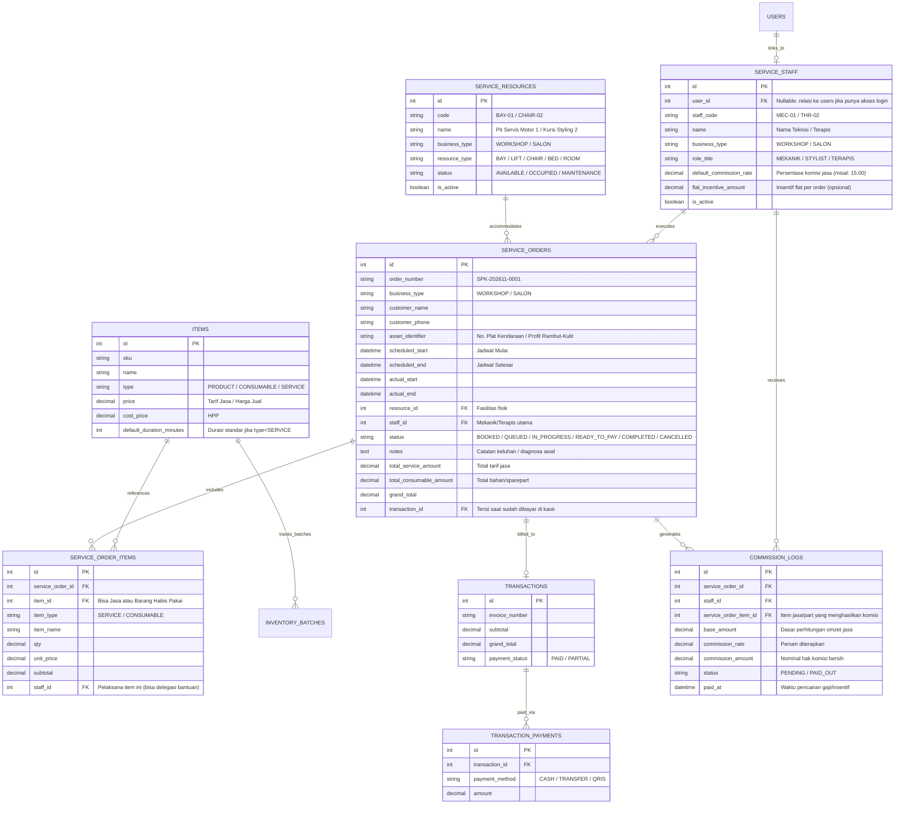
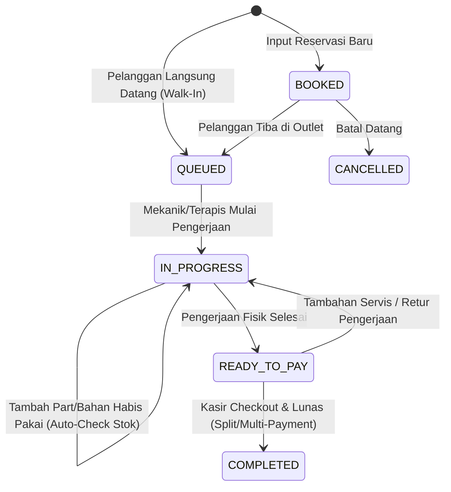

# Arsitektur Teknis & Skema Data (ARCHITECTURE.md)
## SSCM — Service Supply Chain Management System

Dokumen ini mendefinisikan arsitektur sistem, skema database relasional (Knex / SQLite), algoritma validasi bisnis, dan arsitektur antarmuka frontend berbasis gaya dan stack **TokoJendral**.

---

## 1. Diagram Arsitektur Tingkat Tinggi (High-Level Architecture)

```
+---------------------------------------------------------------------------------+
|                       FRONTEND: Modular Vanilla JS SPA                          |
|  - public/index.html (Login) & public/pages/dashboard.html                      |
|  - Components: Sidebar.js, Services.js (Booking & Queue Board), POS.js,         |
|                Commissions.js, Reports.js                                       |
|  - Utilities: api.js (Fetch/JWT), format.js (Rupiah & Tanggal)                  |
|  - CSS: style.css (TokoJendral UI System: Dark/Light Card, Modals, Badges)      |
+----------------------------------------+----------------------------------------+
                                         | REST API (JSON + Bearer JWT)
+----------------------------------------v----------------------------------------+
|                          BACKEND: Express.js (v5.x)                             |
|  - Middleware: auth.js, rbac.js, validate.js                                    |
|  - Controllers: ServiceController, BookingController, CommissionController     |
|  - Services:                                                                    |
|    * CollisionEngineService (Overlap checking Fasilitas x Staf x Waktu)         |
|    * ServiceOrderService (Lifecycle SPK: BOOKED -> QUEUED -> IN_PROG -> READY)  |
|    * FIFOInventoryService (Auto deduct batch stok sparepart/oli/serum)          |
|    * CommissionCalculationService (Auto logging komisi per staf)                |
+----------------------------------------+----------------------------------------+
                                         | Knex.js Query Builder
+----------------------------------------v----------------------------------------+
|                      DATABASE: SQLite3 (better-sqlite3)                         |
|  - Tabel Inti TokoJendral: users, items, inventory_batches, transactions        |
|  - Tabel Domain SSCM: service_resources, service_staff, service_orders,         |
|                       service_order_items, commission_logs                      |
+---------------------------------------------------------------------------------+
```

---

## 2. Entity-Relationship Diagram (ERD)



---

## 3. Spesifikasi Skema & Kamus Data Teknis

### A. Tabel `service_resources` (Fasilitas Fisik)
Menyimpan data stasiun kerja berkapasitas 1 pengerjaan pada satu waktu:
* `id`: INTEGER PRIMARY KEY AUTOINCREMENT
* `code`: VARCHAR(20) UNIQUE NOT NULL (Contoh: `'BAY-01'`, `'BED-SPA-03'`)
* `name`: VARCHAR(100) NOT NULL
* `business_type`: VARCHAR(20) NOT NULL CHECK (`business_type` IN (`'WORKSHOP'`, `'SALON'`))
* `resource_type`: VARCHAR(20) NOT NULL (`'BAY'`, `'LIFT'`, `'CHAIR'`, `'BED'`, `'ROOM'`)
* `status`: VARCHAR(20) DEFAULT `'AVAILABLE'`
* `is_active`: BOOLEAN DEFAULT 1

### B. Tabel `service_staff` (Tenaga Ahli)
Menyimpan profil teknisi atau terapis pelaksana:
* `id`: INTEGER PRIMARY KEY AUTOINCREMENT
* `user_id`: INTEGER NULL REFERENCES `users(id)` ON DELETE SET NULL
* `staff_code`: VARCHAR(20) UNIQUE NOT NULL
* `name`: VARCHAR(100) NOT NULL
* `business_type`: VARCHAR(20) NOT NULL CHECK (`business_type` IN (`'WORKSHOP'`, `'SALON'`))
* `role_title`: VARCHAR(50) NOT NULL (`'MEKANIK'`, `'STYLIST'`, `'TERAPIS'`, `'DOKTER'`)
* `default_commission_rate`: DECIMAL(5,2) DEFAULT 0.00 (Contoh: 15.00 berarti 15%)
* `flat_incentive_amount`: DECIMAL(12,2) DEFAULT 0.00
* `is_active`: BOOLEAN DEFAULT 1

### C. Tabel `service_orders` (SPK & Booking)
Pusat pencatatan siklus pengerjaan layanan:
* `id`: INTEGER PRIMARY KEY AUTOINCREMENT
* `order_number`: VARCHAR(30) UNIQUE NOT NULL (Contoh: `'SPK-202611-0001'`)
* `business_type`: VARCHAR(20) NOT NULL
* `customer_name`: VARCHAR(100) NOT NULL
* `customer_phone`: VARCHAR(30)
* `asset_identifier`: VARCHAR(100) NOT NULL (No. Polisi Kendaraan untuk Bengkel, atau Tipe Perawatan Rambut/Kulit untuk Salon)
* `scheduled_start`: DATETIME NOT NULL
* `scheduled_end`: DATETIME NOT NULL
* `actual_start`: DATETIME NULL
* `actual_end`: DATETIME NULL
* `resource_id`: INTEGER NOT NULL REFERENCES `service_resources(id)`
* `staff_id`: INTEGER NOT NULL REFERENCES `service_staff(id)`
* `status`: VARCHAR(20) DEFAULT `'BOOKED'` CHECK (`status` IN (`'BOOKED'`, `'QUEUED'`, `'IN_PROGRESS'`, `'READY_TO_PAY'`, `'COMPLETED'`, `'CANCELLED'`))
* `notes`: TEXT
* `total_service_amount`: DECIMAL(12,2) DEFAULT 0.00
* `total_consumable_amount`: DECIMAL(12,2) DEFAULT 0.00
* `grand_total`: DECIMAL(12,2) DEFAULT 0.00
* `transaction_id`: INTEGER NULL REFERENCES `transactions(id)`

### D. Tabel `service_order_items`
Rincian item tindakan jasa dan bahan habis pakai:
* `id`: INTEGER PRIMARY KEY AUTOINCREMENT
* `service_order_id`: INTEGER NOT NULL REFERENCES `service_orders(id)` ON DELETE CASCADE
* `item_id`: INTEGER NOT NULL REFERENCES `items(id)`
* `item_type`: VARCHAR(20) NOT NULL CHECK (`item_type` IN (`'SERVICE'`, `'CONSUMABLE'`))
* `item_name`: VARCHAR(150) NOT NULL
* `qty`: DECIMAL(10,2) DEFAULT 1.00
* `unit_price`: DECIMAL(12,2) NOT NULL
* `subtotal`: DECIMAL(12,2) NOT NULL
* `staff_id`: INTEGER NULL REFERENCES `service_staff(id)`

### E. Tabel `commission_logs`
Pencatatan hak insentif dan komisi karyawan:
* `id`: INTEGER PRIMARY KEY AUTOINCREMENT
* `service_order_id`: INTEGER NOT NULL REFERENCES `service_orders(id)`
* `staff_id`: INTEGER NOT NULL REFERENCES `service_staff(id)`
* `service_order_item_id`: INTEGER NULL REFERENCES `service_order_items(id)`
* `base_amount`: DECIMAL(12,2) NOT NULL
* `commission_rate`: DECIMAL(5,2) NOT NULL
* `commission_amount`: DECIMAL(12,2) NOT NULL
* `status`: VARCHAR(20) DEFAULT `'PENDING'` CHECK (`status` IN (`'PENDING'`, `'PAID_OUT'`))
* `paid_at`: DATETIME NULL
* `created_at`: DATETIME DEFAULT CURRENT_TIMESTAMP

---

## 4. Logika Bisnis & Algoritma Utama

### 4.1. Collision Detection Engine (Anti-Tabrakan Jadwal)
Untuk setiap order baru atau perubahan jadwal dengan rentang $[T_{\text{start}}, T_{\text{end}}]$, backend mengeksekusi validasi bebas bentrok:

```sql
SELECT id, order_number, scheduled_start, scheduled_end 
FROM service_orders 
WHERE status NOT IN ('COMPLETED', 'CANCELLED')
  AND id != :current_order_id
  AND (resource_id = :target_resource_id OR staff_id = :target_staff_id)
  AND (scheduled_start < :target_end AND scheduled_end > :target_start);
```

* **Aturan:** Jika query mengembalikan minimal 1 baris, sistem **menolak** penyimpanan dan mengirim pesan error deskriptif (apakah fasilitas yang bentrok atau staf yang sedang bertugas).

### 4.2. State Machine Siklus Order Servis



### 4.3. Atomic Checkout & Pemotongan Stok FIFO di Kasir
Saat kasir menekan tombol bayar untuk order servis:
1. **Buka Database Transaction (`knex.transaction`)**:
2. **Rekam Transaksi Penjualan:**
   * Buat baris baru di `transactions`.
   * Simpan detail rincian pembayaran di `transaction_payments` (misal Rp 100.000 Cash + Rp 250.000 QRIS).
3. **Potong Stok FIFO Bahan Habis Pakai:**
   * Ambil setiap baris `service_order_items` yang bertipe `'CONSUMABLE'`.
   * Potong kuantitas dari `inventory_batches` dengan urutan batch terlama (`ORDER BY received_date ASC, id ASC`).
   * Catat snapshot HPP riil pada transaksi kasir.
4. **Hitung & Terbitkan Komisi Karyawan:**
   * Hitung komisi dari tarif jasa pengerjaan:
     $$\text{Komisi} = \text{Tarif Jasa} \times \left(\frac{\text{commission\_rate}}{100}\right)$$
   * Simpan ke tabel `commission_logs` berstatus `'PENDING'`.
5. **Finalisasi Status Order:**
   * Update status `service_orders` menjadi `'COMPLETED'` dan pasang relasi `transaction_id`.
6. **Commit Transaction.**

---

## 5. Arsitektur Antarmuka Pengguna (UI TokoJendral Style)

Frontend mengadopsi struktur komponen modular yang selaras dengan `TokoJendral/public/`:

```
public/js/
├── app.js                      # Router & Active Page State Manager
├── api.js                      # Centralized Fetch Client dengan Auth Token
├── components/
│   ├── Sidebar.js              # Navigasi: Dashboard, Services (SSCM), POS, Commissions, Reports
│   ├── Services.js             # Komponen Utama SSCM:
│   │   ├── Tab Booking & Reservasi (Form Booking + Cek Slot Kosong)
│   │   └── Tab Papan Antrean (Queue Board 4 Kolom: Queued, In Progress, Ready, Done)
│   ├── POS.js                  # Modul Kasir TokoJendral yang di-extend:
│   │   └── Modal "Panggil Antrean Servis" (Load Order SPK ke Cart)
│   └── Commissions.js          # Rekapitulasi Hak Komisi Staf & Tombol Settlement Gaji
└── utils/
    └── format.js               # Formatter IDR (Rupiah), Badges Status, Date-Time
```

---

## 6. Rencana Endpoint REST API

| Method | Endpoint | Fungsi | Akses Role |
| :--- | :--- | :--- | :--- |
| `GET` | `/api/services/resources` | Daftar fasilitas fisik & ketersediaan | `all` |
| `GET` | `/api/services/staff` | Daftar staf teknisi & terapis aktif | `all` |
| `GET` | `/api/services/orders` | Ambil data antrean & reservasi (filter status/tanggal) | `all` |
| `POST` | `/api/services/orders` | Buat order/booking baru (dengan collision guard) | `cashier`, `admin` |
| `PUT` | `/api/services/orders/:id/status` | Ubah status pengerjaan (`QUEUED` $\to$ `IN_PROGRESS` $\to$ `READY`) | `technician`, `cashier`, `admin` |
| `POST` | `/api/services/orders/:id/items` | Tambah konsumsi sparepart/bahan habis pakai | `technician`, `cashier`, `admin` |
| `GET` | `/api/services/orders/ready-to-pay` | Ambil daftar order siap bayar untuk kasir | `cashier`, `admin` |
| `POST` | `/api/services/orders/:id/checkout` | Eksekusi checkout POS, potong FIFO, dan buat komisi | `cashier`, `admin` |
| `GET` | `/api/commissions` | Laporan rekapitulasi komisi teknisi | `admin`, `owner` |
| `POST` | `/api/commissions/payout` | Pembayaran/settlement komisi staf terpilih | `admin`, `owner` |
